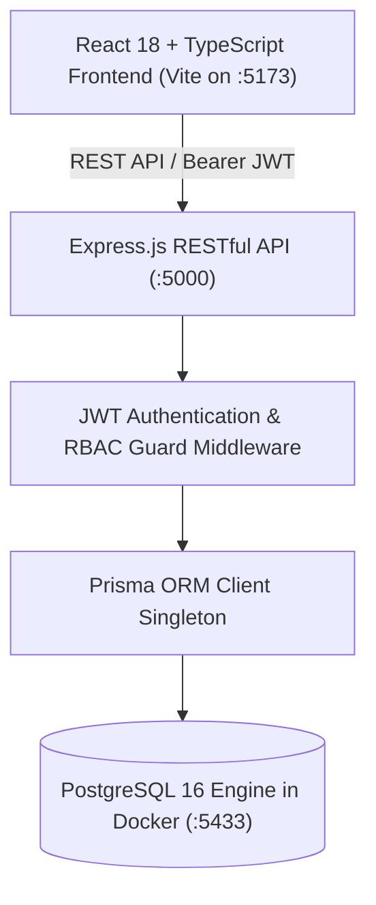

# WorkNest EMS — Enterprise System Walkthrough

WorkNest EMS is a production-grade, full-stack **Enterprise Employee Management System (EMS)** designed for modern workforce operations. It features a clean blue-and-white SaaS aesthetic, role-based access control (RBAC), modular architecture, real-time PostgreSQL database persistence via Prisma ORM, interactive data visualizations, and business intelligence reporting with CSV export.

---

## 🏛️ System Architecture



---

## 📦 Core Modules Walkthrough

### 1. Executive Dashboard (`/`)
- **Live Workforce KPIs**: Instant metrics for Total Employees, Active Personnel, On-Leave Count, Present Today, Late Arrivals, and Total Monthly Payroll.
- **Department Distribution**: Progress bars displaying headcount and organizational percentage per department.
- **Weekly Attendance Trends**: 7-day visual bar charts displaying On-time, Late, and Absent rates.
- **Recent Onboarding Roster**: Latest hires with joining dates, avatars, job titles, and departments.
- **Pending Leave Approvals**: Actionable dashboard table allowing HR and Admins to approve or reject leave requests in 1 click.
- **Operational Shortcuts**: Quick navigation ribbons to immediately add employees, log attendance, submit leaves, and generate payroll.

### 2. Employee Management (`/employees`)
- **Directory Search & Filters**: Search in real time by name, employee code (e.g. `EMP-001`), email, and title. Multi-factor filtering by Department, Status (`ACTIVE`, `ON_LEAVE`, `TERMINATED`), and Type (`FULL_TIME`, `PART_TIME`, `CONTRACT`, `INTERN`).
- **Full CRUD Support**: Add new employees with automated code generation, edit existing records, and safely delete with confirmation dialogs.
- **Comprehensive Profile Modal**: Modal inspecting contact information, department details, compensation breakdown (basic, allowances, deductions), and annual leave balances.

### 3. Department Management (`/departments`)
- **Department Cards**: Summary cards showing department codes, team sizes, allocated annual operating budgets, and designated department heads.
- **Department Roster**: Interactive modal displaying all staff assigned to a department.
- **Budget Tracking**: Organization-wide budget aggregation and department-level allocations.
- **Safe CRUD**: Creation, editing, and guarded deletions that prevent accidental deletion of populated units.

### 4. Attendance Tracking (`/attendance`)
- **Self-Service Punch Widget**: Real-time header punch clock allowing logged-in employees to punch in and punch out with live work hours tracked.
- **Daily Attendance Roster**: Date-picker roster displaying punch-in time, punch-out time, total work hours, and status badges (`PRESENT`, `LATE`, `HALF_DAY`, `ABSENT`).
- **Manager Overrides**: Admin and HR can manually adjust timestamps, change statuses, and log administrative notes.
- **Daily Summary**: Calculates on-time arrival rate, tardiness, and unexcused absences.

### 5. Leave Management (`/leaves`)
- **Balance Quotas**: Real-time tracking of Annual (15d), Sick (10d), and Casual (10d) leave quotas.
- **Leave Application Modal**: Multi-day calculator with reason justification and validation against remaining quotas.
- **Dual-Action Approvals**: HR/Admin review pipeline supporting 1-click approvals and rejections with mandatory notes.
- **Automatic Balance Deductions**: Approving leaves automatically deducts from the employee's active yearly quota.

### 6. Payroll & Compensation (`/payroll`)
- **Configurable Salary Structures**: Base salary, allowances (HRA, Conveyance, Medical, Special), and statutory deductions (Provident Fund, Tax).
- **Batch Payroll Engine**: 1-click generation of monthly payroll records across all active personnel.
- **Disbursement Workflow**: Tracks statuses across `DRAFT` ➔ `PROCESSED` ➔ `PAID`.
- **Itemized Printable Payslip**: Corporate pay stub modal with company letterhead, full earnings, deductions, net salary, and browser print styling.

### 7. Reports & Analytics (`/reports`)
- **4 Real-Time Report Domains**:
  1. Employee Directory Report
  2. Monthly Attendance Report
  3. Leave Summary Report
  4. Payroll & Compensation Report
- **Live Tabular Previews**: Data table preview with department and date range filters.
- **Instant CSV Export**: Direct 1-click spreadsheet download for all 4 report types.

### 8. System Settings & Security (`/settings`)
- **Company Profile**: Edit company name, contact email, phone, physical address, currency symbol, and timezone.
- **User Accounts**: Manage login accounts, toggle active/disabled states, and reassign roles.
- **RBAC Matrix**: Visual breakdown of Admin, HR, and Employee authorizations.
- **Security Audit Logs**: Chronological timeline of administrative system events.

### 9. Authentication & RBAC
- **Secure JWT Auth**: Hashed passwords with `bcryptjs`, signed JWT tokens, and token expiration handling.
- **Role-Based Guards**: Server-side route authorization and UI controls for `ADMIN`, `HR`, and `EMPLOYEE`.
- **1-Click Demo Logins**: Dedicated login buttons for instant evaluation without typing credentials.

---

## 🔑 Demo Credentials

| Role | Email | Password | Access Level |
|---|---|---|---|
| **Admin** | `admin@enterprise-ems.com` | `Admin@123` | Full access across all 9 modules, system settings, and user management |
| **HR Manager** | `hr@enterprise-ems.com` | `Hr@123` | Employee CRUD, department assignments, attendance adjustments, leave approvals, payroll, and reports |
| **Employee** | `john.doe@enterprise-ems.com` | `Emp@123` | Self-service attendance punching, personal leave applications, and individual payslips |

---

## 🚀 Quick Start Guide

### 1. Database (Docker PostgreSQL on Port 5433)
```bash
docker compose up -d
```

### 2. Backend Server (Port 5000)
```bash
cd backend
npm install
npx prisma db push
npx tsx prisma/seed.ts
npm run dev
```

### 3. Frontend Client (Port 5173)
```bash
cd frontend
npm install
npm run dev
```

Visit **`http://localhost:5173`** to access the system.

---

## 📁 Key File References

- **Setup Guide**: [`SETUP.md`](SETUP.md)
- **Backend Entry Point**: [`backend/src/index.ts`](backend/src/index.ts)
- **Express App & Routing**: [`backend/src/app.ts`](backend/src/app.ts)
- **Database Schema**: [`backend/prisma/schema.prisma`](backend/prisma/schema.prisma)
- **Seeding Script**: [`backend/prisma/seed.ts`](backend/prisma/seed.ts)
- **Frontend App Router**: [`frontend/src/App.tsx`](frontend/src/App.tsx)
- **Design System CSS**: [`frontend/src/index.css`](frontend/src/index.css)
- **API Client**: [`frontend/src/services/api.ts`](frontend/src/services/api.ts)
